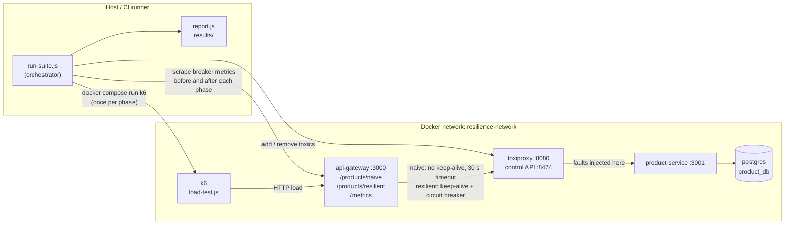

# k6 + Toxiproxy Resilience Suite

[](https://github.com/maneesh96/k6-toxiproxy-resilience-suite/actions/workflows/perf.yml)

A chaos-engineering experiment for a small microservice stack. k6 drives load
through an API gateway while Toxiproxy injects faults between the gateway and
the product service. The suite runs four phases, measures each one, and
reports whether that phase's hypothesis held. The fault is the same in
phases 2 and 4: phase 2 shows what it does to a naive call path, phase 4 what
a circuit breaker does about it.

Everything runs in Docker, k6 included, so the only things you need on the
host are Docker (with Compose v2) and Node.js 20 or newer.

## Architecture



| Component | File | Role |
| :--- | :--- | :--- |
| Product service | `product-service.js`, `init-db.sql` | Express + `pg`; serves the catalog from Postgres, returns 503 (not canned data) when the database fails |
| API gateway | `gateway.js`, `breaker-metrics.js` | Two paths to the same downstream. `/products/naive`: new connection per call, 30 s timeout. `/products/resilient`: keep-alive pool and an [opossum](https://github.com/nodeshift/opossum) circuit breaker (800 ms timeout, opens at 50% failures over at least 10 calls, half-opens after 10 s, bulkhead of 50) with a degraded fallback payload. `/metrics` exposes breaker state and events for Prometheus |
| Toxiproxy | `docker-compose.yml` | Sits between gateway and product service; the orchestrator adds latency, bandwidth and slicer toxics through its API |
| Load generator | `load-test.js` | k6 script; checks the body is the real catalog, counts fallback payloads in the custom `degraded_responses` rate, applies baseline and per-phase thresholds |
| Orchestrator | `run-suite.js` | Builds and starts the stack, waits until a real catalog comes back through every hop, runs the four phases, writes `results/` |
| Report | `report.js` | Turns the k6 summaries and the phase manifest into `report.md`, `report.json` and the CI summary table; nothing in it is pre-written |

## The four phases

| Phase | Path | Fault (Toxiproxy, downstream) | Hypothesis |
| :--- | :--- | :--- | :--- |
| 1. Steady-state baseline | naive | none | Meets every baseline SLO |
| 2. Unmitigated latency | naive | latency 2000 ± 500 ms | Latency SLO breached, but every caller still gets the real catalog within 3 s |
| 3. Bandwidth starvation | naive | 10 KB/s + 10-byte slices | Latency SLO breached, catalog still arrives intact well within a second |
| 4. Latency behind the breaker | resilient | latency 2000 ± 500 ms | Circuit opens, callers get the degraded fallback instead of errors, tail latency far below phase 2 |

Each phase is judged twice. The **baseline SLOs** in `load-test.js` are the
same for every phase (errors < 1%, p95 < 200 ms, p99 < 500 ms, checks > 99%,
degraded responses < 1%), so the phases compare; chaos phases are expected to
breach some of them. The **phase SLOs** in `run-suite.js` are what a phase must
still guarantee under its fault. A phase's hypothesis is "confirmed" only when
the expected breaches happen *and* its phase SLOs hold, so a breach of the
baseline in a chaos phase is a result, not a failed build. Details and the
reasoning behind each bound: [docs/circuit-breaker.md](docs/circuit-breaker.md).

## Results from CI

Latest run on `main`: [run 39450408585](https://github.com/maneesh96/k6-toxiproxy-resilience-suite/actions/runs/39450408585)
(commit `66a3a3a`, 2026-10-20), GitHub-hosted `ubuntu-latest`, 10 VUs per
phase, 3 s ramp-up, 15 s steady state, 2 s ramp-down.

| Phase | Requests | Throughput | p95 | p99 | Max | HTTP errors | Degraded | Baseline SLOs | Phase SLOs | Hypothesis |
| :--- | ---: | ---: | ---: | ---: | ---: | ---: | ---: | :--- | :--- | :--- |
| 1. Baseline | 1673 | 83.3 req/s | 8.83 ms | 16.01 ms | 35.01 ms | 0% | 0% | met | n/a | confirmed |
| 2. Latency, naive | 90 | 4.1 req/s | 2.45 s | 2.49 s | 2.49 s | 0% | 0% | breached (p95, p99) | met | confirmed |
| 3. Bandwidth, naive | 556 | 27.7 req/s | 223.72 ms | 225.56 ms | 227.79 ms | 0% | 0% | breached (p95) | met | confirmed |
| 4. Latency, breaker | 1639 | 81.8 req/s | 1.50 ms | 3.26 ms | 802.98 ms | 0% | 100% | breached (checks, degraded) | met | confirmed |

Circuit breaker during phase 4: 13 calls timed out at 800 ms, the circuit
opened twice (one half-open trial in between failed under the toxic), and
the remaining 1626 calls were rejected straight to the fallback. It ended the
run open (state `2`).

What the numbers say:

- **Latency passes straight through a naive path.** With 2 s ± 500 ms of
  downstream latency, p95 went from 8.8 ms to 2.45 s and throughput fell from
  83 to 4 req/s: each virtual user spent its time waiting. No request failed,
  which is exactly why this mode is dangerous; nothing alerts on errors.
- **A starved link costs a predictable amount.** At 10 KB/s with 10-byte
  slices the ~1 KB catalog took about 220 ms every time (p95 to max within
  5 ms), enough to breach the 200 ms baseline but well inside the 1 s phase SLO.
- **The breaker trades freshness for availability.** Under the same fault as
  phase 2, p99 fell from 2.49 s to 3.3 ms and throughput stayed at baseline
  level, but every response was the degraded fallback. The 803 ms maximum is
  the breaker's own 800 ms timeout on the calls made before it opened. The
  50% check rate is the "body is the product catalog" check failing on every
  fallback, which is the expected cost of degrading.

These are short smoke-length phases on a shared CI runner, so read them as
relative behaviour between phases, not as capacity figures. The full report
for every run (`report.md`, `report.json`, raw k6 summaries and
`phases.json`) is in that run's `resilience-results` artifact, and the
comparison table is on the run's summary page.

## Running it

```sh
npm ci
cp .env.example .env    # then change POSTGRES_PASSWORD
npm run suite
```

`npm run suite` builds the image, starts the stack with healthchecks, runs the
four phases and stops the stack. Results land in `results/` (git-ignored). It
exits non-zero only if the experiment could not be carried out (stack not
healthy, k6 crashed); breached thresholds are recorded in the report instead.

Without overrides each phase runs 100 VUs for 5 s + 30 s + 5 s. Override with
environment variables:

| Variable | Default | Meaning |
| :--- | :--- | :--- |
| `VUS` | `100` | peak virtual users per phase |
| `RAMP_UP` / `DURATION` / `RAMP_DOWN` | `5s` / `30s` / `5s` | k6 stage durations |
| `SLEEP_DURATION` | `0.1` | think time per iteration, seconds |
| `KEEP_STACK_UP` | unset | `1` leaves the containers running afterwards |
| `TOXIPROXY_API_URL` | `http://localhost:8474` | Toxiproxy control API as seen from the host |
| `GATEWAY_URL` | `http://localhost:3000` | gateway as seen from the host |

The CI settings, for a quick local run:

```sh
VUS=10 RAMP_UP=3s DURATION=15s RAMP_DOWN=2s npm run suite
```

Other commands:

```sh
npm test              # unit tests for report.js and breaker-metrics.js (no Docker)
npm run check         # node --check on every script
npm run report        # rebuild the report from an existing results/ directory

# one ad-hoc k6 run against a running stack
docker compose up -d --wait
docker compose --profile load run --rm k6 run /scripts/load-test.js
docker compose --profile load down --volumes
```

To watch the circuit breaker change state live during phase 4, see
[docs/circuit-breaker.md](docs/circuit-breaker.md#watching-it-live).

## CI

`.github/workflows/perf.yml` runs on pushes to `main` and `staging`, on pull
requests, and on demand:

1. **validate**: `npm ci`, `node --check` on every script, unit tests,
   `docker compose config`, and `k6 inspect` on the load script.
2. **resilience**: the full four-phase suite at 10 VUs with 15 s phases,
   breaker metrics after the run, the comparison table in the job summary and
   `results/` uploaded as the `resilience-results` artifact (kept 30 days).

Run the workflow manually (Actions → Performance Suite → Run workflow) to set
`vus` and `duration` for a longer experiment.

## Repository layout

```
gateway.js            API gateway: naive and resilient paths, /metrics
breaker-metrics.js    Prometheus metrics for the circuit breaker
product-service.js    catalog service backed by Postgres
init-db.sql           schema and seed data
load-test.js          k6 script: checks, degraded_responses, thresholds
run-suite.js          orchestrator for the four phases
report.js             report built from the measured results
docker-compose.yml    postgres, product-service, toxiproxy, api-gateway, k6
Dockerfile            one Node image for both services
docs/                 circuit breaker metrics and per-phase SLOs
test/                 node:test unit tests and k6 summary fixtures
```
